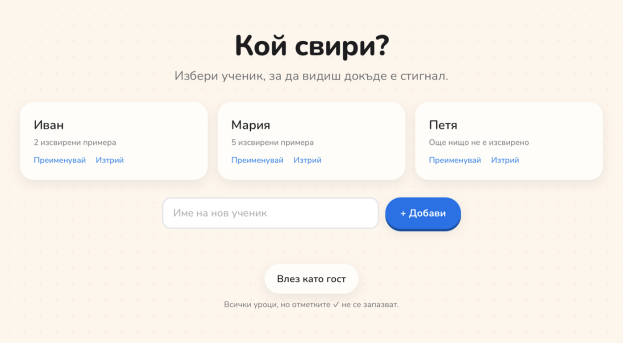
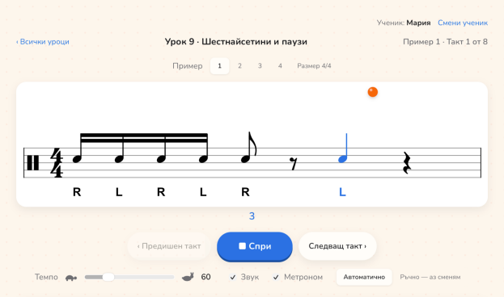

# Уроци по ударни инструменти

**Приложение за обучение по четене и изпълнение на ритъм на малък барабан**

Национален есенен турнир по информационни технологии „Джон Атанасов“ – София, декември 2026

|  |  |
|---|---|
| **Направление** | Разпределени приложения |
| **Автор** | Саркис Степан Демирджиян, клас: 11 |
| **Училище** | Професионална гимназия по електротехника и електроника – гр. Пловдив |
| **Ръководител** | Мариана Стоянова Христозкова, старши учител по теоретично обучение |
| **Сайт** | https://sako4018.github.io/percussion-lessons/ |
| **Код** | https://github.com/sako4018/percussion-lessons |

## Съдържание

- [Увод](#увод)
- [Глава 1. Основни етапи в реализирането на проекта](#глава-1-основни-етапи-в-реализирането-на-проекта)
- [Глава 2. Реализация на поставените цели – използвани технологии](#глава-2-реализация-на-поставените-цели--използвани-технологии)
- [Глава 3. Логическо и функционално описание на решението](#глава-3-логическо-и-функционално-описание-на-решението)
- [Глава 4. Реализация на разработката](#глава-4-реализация-на-разработката)
- [Глава 5. Описание на приложението](#глава-5-описание-на-приложението)
- [Заключение](#заключение)
- [Използвани източници](#използвани-източници)

## Увод

**Предназначение.** „Уроци по ударни инструменти“ е приложение за обучение по четене и изпълнение на ритъм на малък барабан. То показва нотите такт по такт, изсвирва ги и отбелязва звучащата нота с подскачащо топче. Предназначено е за учители по музика в час и за ученици при самостоятелна работа. Работи като програма за компютър и като сайт, включително на телефон.

**Потребности.** В хартиения сборник нотите не се чуват и ученикът не може да се провери сам. Нужни са: (1) уроци от лесни към трудни; (2) звук в избрано темпо; (3) отбелязване на текущата нота; (4) напредък за всеки ученик.

**Съществуващи решения.** Приложения като Melodics и Rhythm Trainer са предимно платени, на английски език и рядко съдържат неравноделни размери (7/8, 9/8), характерни за българската музика. Решението е безплатно, на български език и включва такива уроци.

**Критерии за успех:**

1. всичките 50 урока (по 4 примера с по 8 такта) се свирят без грешка;
2. топчето пада върху нотата в момента на удара;
3. напредъкът на всеки ученик се запазва.

## Глава 1. Основни етапи в реализирането на проекта

### 1.1. Етапи в реализирането на проекта

- **Основа:** прозорец на Python с уеб страница, генератор на уроци, подскачащо топче.
- **Съдържание и дизайн:** 50 урока до 12/8, триоли и секстоли; детски интерфейс със седем цветни раздела.
- **Ученици и база данни:** модулен код, екран „Кой свири?“, напредък на всеки ученик в SQLite.
- **Онлайн версия:** GitHub Pages, изглед за телефон, ученици в браузъра, вход като гост.
- **Тестване:** приложението е изпробвано от двама преподаватели по ударни инструменти, които дават писмени мнения (виж [Заключение](#заключение)).

### 1.2. Роли на авторите

Проектът е разработен от един автор – идея, програмиране, съдържание на уроците, тестване и документация.

## Глава 2. Реализация на поставените цели – използвани технологии

Уеб страница сама не може да пази база данни на компютъра, а Tkinter няма нотопис и точен звук. Затова са избрани Python с pywebview за прозореца и данните, чист JavaScript за интерфейса, VexFlow за нотите, Web Audio API за звука, SQLite и GitHub Pages.

## Глава 3. Логическо и функционално описание на решението

### 3.1. Архитектура и модули

Системата е на три слоя: представяне (`app/`), логика (тактове, свирене, отметки) и данни. Данните имат две реализации с еднакви функции – `main.py` със SQLite на компютъра и `browser-api.js` с localStorage в сайта.

| Модул | Предназначение |
|---|---|
| `main.py`, `browser-api.js` | Уроците, учениците и напредъкът (SQLite / localStorage); експорт в `progress.sql`. |
| `students.js` | Екран „Кой свири?“: добавяне, преименуване, изтриване, вход като гост. |
| `lessons.js`, `notes.js` | Разчитане и проверка на тактовете, рисуване на нотите. |
| `sound.js`, `player.js`, `ball.js` | Звук и метроном, свирене такт по такт, топче. |
| `screens.js`, `practice.js`, `bravo.js` | Списък с уроци, упражнение, прозорец „Браво“. |
| `tools/gen_lessons.py` | Създава `app/lessons.json` с всички уроци. |

### 3.2. Работен сценарий

При стартиране се избира ученик или вход като гост (Фигура 1) и се показват уроците. В урока се избират пример, темпо и режим; при „Свири“ звучащата нота се оцветява, а топчето пада върху нея (Фигура 2). Изсвиреният докрай пример получава отметка за ученика; при гост отметките не се записват.

## Глава 4. Реализация на разработката

### 4.1. Технологични средства и инструменти

`sqlite3` е вграден в Python; pywebview показва интерфейса без браузър и сървър; GitHub Actions публикува сайта автоматично. Използвани са Visual Studio Code, Git и GitHub, XAMPP с phpMyAdmin и macOS.

### 4.2. Описание и обосновка на алгоритмите

- **Разчитане на такт.** Всяка нота е запис `дължина:удар:надпис` (напр. `qd:sd:R`). Продължителностите се сумират в четвъртини (с точка × 1,5, в триола × 2/3) и се сравняват с размера.
- **Генериране.** Тактът се пълни със случайни ритмични фрагменти и се приема само ако спазва правилата на урока.
- **Свирене.** Четвъртина трае 60/темпо секунди; всеки удар се подава предварително с точното си време.

## Глава 5. Описание на приложението

### 5.1. Инсталация и стартиране

- **Онлайн:** https://sako4018.github.io/percussion-lessons/ – без инсталация, на компютър или телефон.
- **macOS:** изисква Python 3; проектът се изтегля от https://github.com/sako4018/percussion-lessons и се стартира с „Уроци по ударни инструменти.app“ или `./start.sh`, като pywebview се инсталира автоматично.
- **Деинсталация:** изтриване на папката.
- **Windows и Android:** приложението се използва чрез сайта.

### 5.2. Използване

Всички уроци са отворени. Режимът „Автоматично“ минава такт по такт, а „Ръчно – аз сменям“ повтаря такта до смяна от учителя. Интервалът пуска и спира, стрелките сменят такта.

*Фигура 1. Екран „Кой свири?“*

*Фигура 2. Урок по време на свирене*

### 5.3. Поддръжка

Нови уроци се добавят в `tools/gen_lessons.py` и се създават с `python3 tools/gen_lessons.py`. Промените в клон `main` се публикуват автоматично. Резервно копие – копие на `progress.db`.

## Заключение

Създадено е работещо приложение с 50 урока за малък барабан с точен звук, метроном, отделен напредък за всеки ученик и вход като гост, достъпно на компютър и онлайн.

**Мнения на преподаватели.** Маргарита Демирджиян (старши преподавател по ударни инструменти, НУМТИ „Добрин Петков“ – Пловдив) определя приложението като „изключително полезно за развиване на ритмичното чувство“ и за четене от пръв поглед (prima vista), включително в неравноделните размери от българския фолклор. Ванеса Петкова (преподавател по ударни инструменти) го оценява като „систематизирана методика“ за самоподготовка, подредена както в професионалните музикални училища, с полезна възможност за различно темпо.

**Развитие (по препоръките на преподавателите):** динамични нюанси за контрол на силата на удара, приложения за Android и Windows, технически упражнения за разсвирване, обща онлайн база с акаунти и страница за учителя.

## Използвани източници

- VexFlow. Достъпно към 15.11.2026 г. от https://github.com/0xfe/vexflow
- pywebview – документация. Достъпно към 15.11.2026 г. от https://pywebview.flowrl.com
- MDN Web Docs. Web Audio API. Достъпно към 15.11.2026 г. от https://developer.mozilla.org/en-US/docs/Web/API/Web_Audio_API
- Python Software Foundation. sqlite3. Достъпно към 15.11.2026 г. от https://docs.python.org/3/library/sqlite3.html
- GitHub Docs. GitHub Pages. Достъпно към 15.11.2026 г. от https://docs.github.com/en/pages
