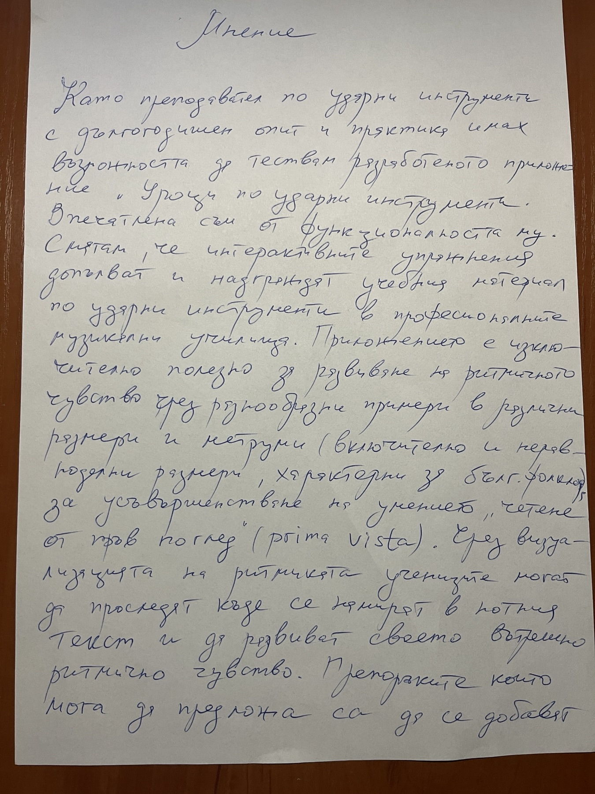
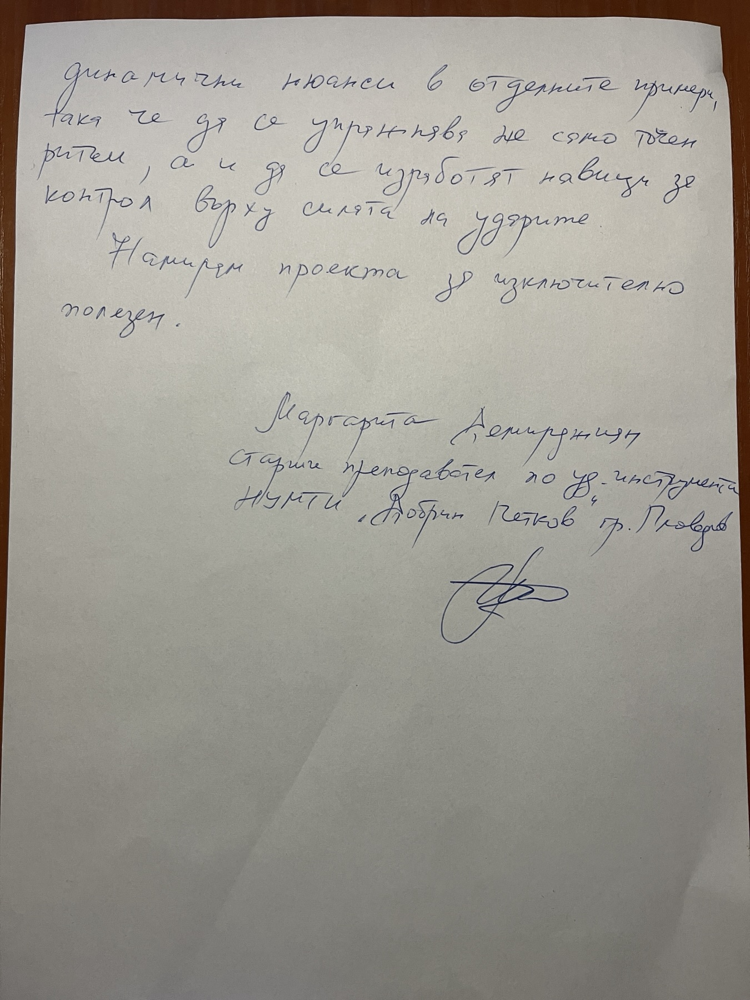
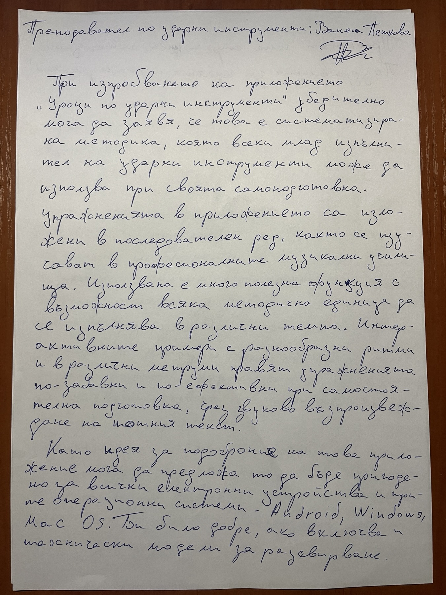
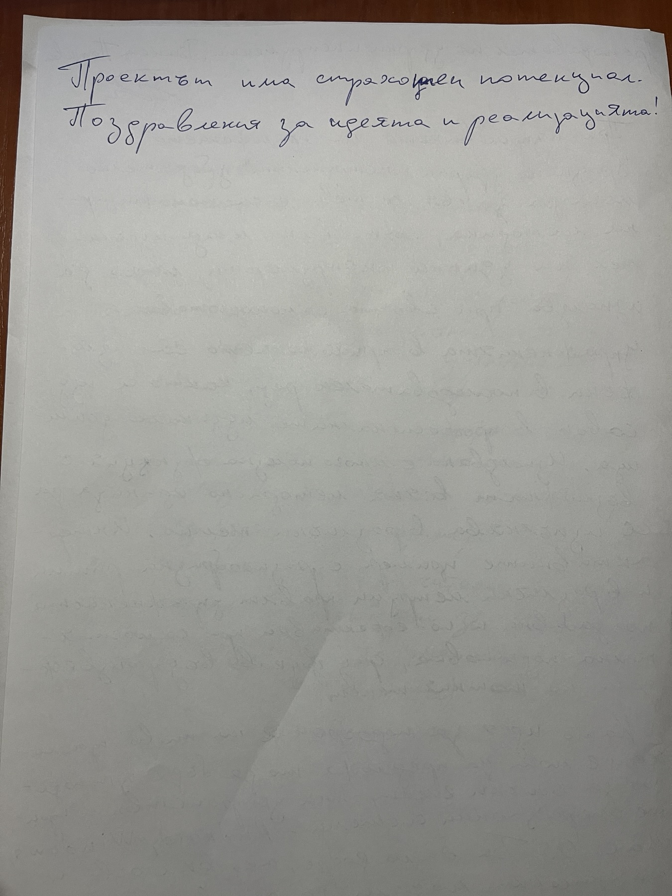

# Мнения на преподаватели

Писмени мнения от преподаватели по ударни инструменти, които изпробваха програмата (ноември 2026).
Под всяка снимка е преписан текстът.

## Маргарита Демирджиян

Старши преподавател по ударни инструменти, НУМТИ „Добрин Петков“ – Пловдив

 

> Като преподавател по ударни инструменти с дългогодишен опит и практика имах възможността да тествам разработеното приложение „Уроци по ударни инструменти“. Впечатлена съм от функционалността му. Смятам, че интерактивните упражнения допълват и надграждат учебния материал по ударни инструменти в професионалните музикални училища. Приложението е изключително полезно за развиване на ритмичното чувство чрез разнообразни примери в различни размери и метруми (включително и неравноделни размери, характерни за българския фолклор), за усъвършенстване на умението „четене от пръв поглед“ (prima vista). Чрез визуализацията на ритмиката учениците могат да проследят къде се намират в нотния текст и да развиват своето вътрешно ритмично чувство. Препоръките, които мога да предложа, са да се добавят динамични нюанси в отделните примери, така че да се упражнява не само точен ритъм, а и да се изработят навици за контрол върху силата на ударите.
>
> Намирам проекта за изключително полезен.

## Ванеса Петкова

Преподавател по ударни инструменти

 

> При изпробването на приложението „Уроци по ударни инструменти“ убедително мога да заявя, че това е систематизирана методика, която всеки млад изпълнител на ударни инструменти може да използва при своята самоподготовка. Упражненията в приложението са изложени в последователен ред, както се изучават в професионалните музикални училища. Използвана е много полезна функция с възможност всяка методична единица да се изпълнява в различни темпа. Интерактивните примери с разнообразни ритми и в различни метруми правят упражненията по-забавни и по-ефективни при самостоятелна подготовка чрез звуково възпроизвеждане на нотния текст.
>
> Като идея за подобрение на това приложение мога да предложа то да бъде пригодено за всички електронни устройства и операционни системи – Android, Windows, Mac OS. Би било добре, ако включва и технически модели за разсвирване.
>
> Проектът има страхотен потенциал. Поздравления за идеята и реализацията!
